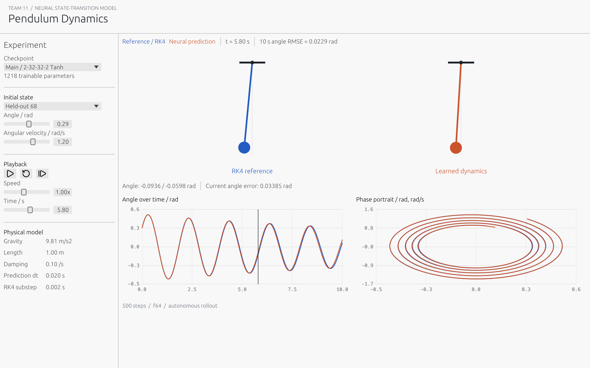

# project11-neural-ode

## Neural Network from Scratch for ODE Solving

Team 11, Course 35-380. A handwritten Rust neural network learns a **fixed-step
state-transition surrogate** for a damped pendulum. This is not a PINN or a
continuous neural vector field. Dense layers, activations, MSE, backpropagation
and mini-batch SGD are implemented manually. ndarray supplies linear algebra;
there is no ML framework or automatic differentiation.

## Quick Start

For the packaged Windows demo, extract WindowsDemo and open pendulum-lab.exe.
The two pretrained models are embedded. Rust, Python and internet access are
not needed for the desktop demonstration. An OpenGL-capable Windows x64 display
environment is required. The Windows C runtime is linked statically.

To build from source, install stable Rust and the platform's native linker
(Visual Studio C++ Build Tools on Windows). Tested with Rust 1.99.0:

    cargo run --release --bin pendulum-lab
    cargo run --release --bin project11 -- gui

The command-line executable also opens the GUI without a subcommand.

## Reproduce the Experiment

Use a new output directory to preserve the published measurements:

    cargo run --release --bin project11 -- reproduce --out experiment
    cargo run --release --bin project11 -- benchmark --out experiment --epochs 50
    python -m pip install -r scripts/requirements.txt
    python scripts/benchmark_numpy.py --root experiment

The first command generates data, trains both models for 200 epochs and evaluates
them. The language benchmark is a separate, identical 50-epoch optimizer workload.
Each implementation warms up once and performs five timed runs. Actual timings
vary with hardware, backend and background load. Startup, input loading and
validation are excluded from benchmark timing.

The CLI exposes generate, train, evaluate, benchmark, reproduce and gui. For
example, train --out experiment --epochs 400 --learning-rate 0.005 changes an
experimental training configuration. Never use final test data to select it.

## Recorded Results

| Quantity | Measured result |
| --- | --- |
| Main network | 2-32-32-2 Tanh, 1,218 parameters |
| Small network | 2-3-2 Sigmoid, 17 parameters |
| Train / validation / test trajectories | 56 / 12 / 12 |
| Held-out one-step angle RMSE | 0.000274373 rad |
| Held-out one-step velocity RMSE | 0.000764793 rad/s |
| Standardized RMSE improvement over persistence | 99.095% |
| Pooled autonomous 10-second angle RMSE | 0.034884 rad |
| OOD initial state | [2.5 rad, 0 rad/s] |
| OOD 10-second angle RMSE | 0.498919 rad |
| 50-epoch median training time | Rust 1.055673 s; NumPy 2.469241 s |

RK4 remains more accurate in this experiment. No inference-speed advantage over
RK4 was measured. Timing compares these two concrete implementations, not the
intrinsic speed of the Rust and Python languages.

## Model and Numerical Contract

- State order is [theta in radians, omega in radians/second]. Angles are not wrapped.
- theta' = omega; omega' = -(g/L) sin(theta) - beta omega.
- g = 9.81, L = 1.0, beta = 0.1, prediction dt = 0.02 s.
- Reference labels use ten RK4 substeps of 0.002 s per prediction step.
- The network predicts standardized increments, decoded and added to its input.
- Normalization uses training trajectories only. Splits are whole trajectories.
- Autonomous rollouts consume the NN's own output without reference resets.
- Checkpoint schema 1 saves weights, dimensions, activations, scaling and physics.
- Invalid custom checkpoints produce errors, never a silent RK4 fallback.

The GUI provides model selection, held-out and OOD presets, initial-state sliders,
play/pause, reset, single-step, speed and timeline controls. Space toggles playback.
A custom model can be opened with gui --model MODEL.json.
pendulum-lab --snapshot FILE.png --preset 2 exports an actual native framebuffer
and exits; the delivered screenshots are not mockups.

## Source and Evidence

| Location | Responsibility |
| --- | --- |
| src/physics.rs | Pendulum equation, RK4, Euler and energy |
| src/nn.rs | Dense network, activations, manual gradients and SGD |
| src/data.rs | Independent trajectories, split validation and scaling |
| src/model.rs | Versioned checkpoint validation and neural inference |
| src/training.rs | Mini-batches, history and validation-only selection |
| src/evaluation.rs | Held-out local errors and independent rollouts |
| src/benchmark.rs | Shared fixture, Rust parity evidence and timing |
| src/gui.rs | Offline native lab and screenshot capture |
| scripts/benchmark_numpy.py | Independent manual NumPy implementation |
| results/ | Raw CSV/JSON measurements and native captures |
| models/ | Frozen main and baseline checkpoints |

Generated data and benchmark_fixture are intentionally ignored by Git. Recreate
them with generate and benchmark. The complete local delivery includes these
inputs for convenience. scripts/summarize_results.py derives report-ready values
from the raw files without changing training.

## Verification and Packaging

    cargo fmt --all -- --check
    cargo test --locked
    cargo test --locked --no-default-features
    cargo clippy --locked --all-targets -- -D warnings
    cargo doc --locked --no-deps
    ./scripts/package_windows.ps1

The default suite has 13 unit tests and 3 integration tests. Core-only mode has
12 unit tests and the same 3 integration tests. GitHub Actions runs Windows
checks, independent NumPy parity and publishes a WindowsDemo artifact.
Packaging copies only the executables, notices and demo instructions.

## Report and Presentation

- [English report, 12 pages](docs/Project11_Report.docx)
- [English PowerPoint, 12 slides](docs/Project11_Presentation.pptx)
- [Seven-minute English script and Chinese reference](docs/SPEAKER_NOTES_bilingual.md)
- [Three-minute demo and bilingual Q&A](docs/DEMO_AND_QA_zh.md)
- [Chinese setup and reading guide](docs/README_zh.md)
- [Team roster and responsibilities](docs/TEAM_RECORD.md)

Slides 1 to 10 form the talk; slides 11 and 12 are Q&A appendices. Use the
3-minute demonstration after the approximately 7-minute talk.

## Licenses

Project code uses MIT. Vendored Lucide interface icons retain their ISC license
in assets/LICENSE.lucide.
